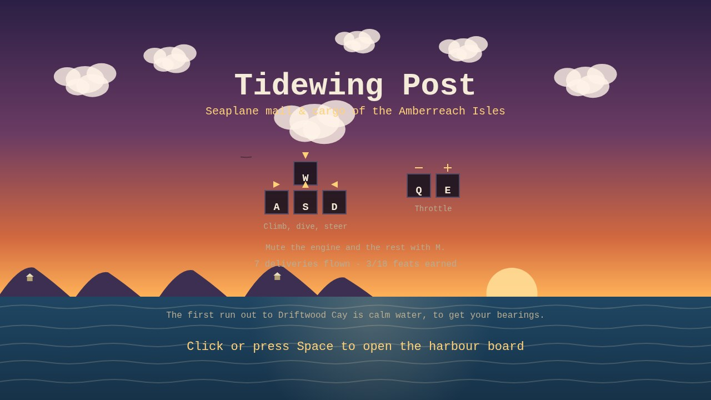
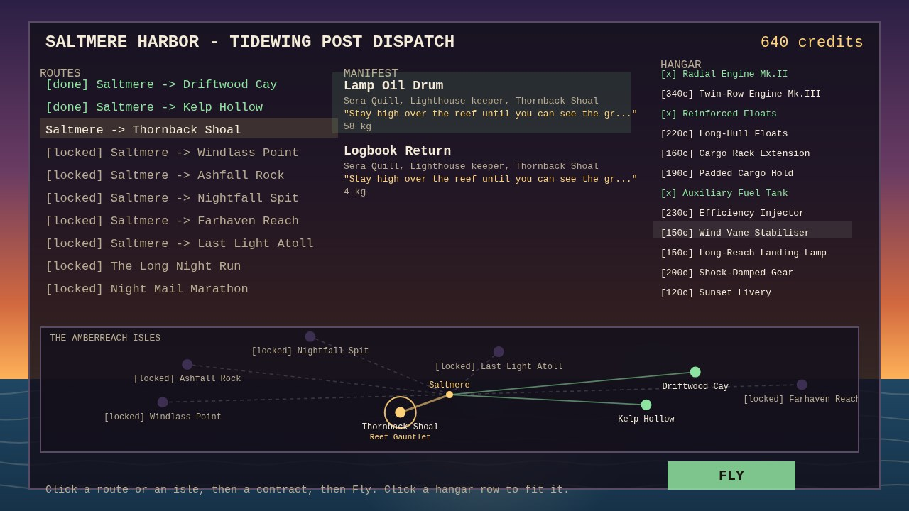
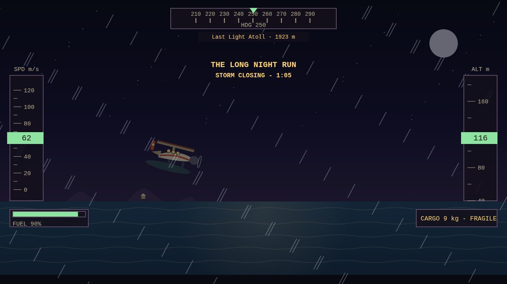
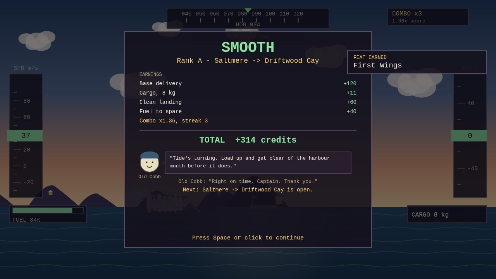

# tidewing-post

[](https://make.fun/bounty/best-flight-game-20261126-0057?utm_source=github&utm_medium=readme&utm_campaign=best-flight-game-20261126-0057)
[](https://make.fun/bounty/best-flight-game-20261126-0057/leaderboard?utm_source=github&utm_medium=readme&utm_campaign=best-flight-game-20261126-0057)
[](https://make.fun/bounty/best-flight-game-20261126-0057?utm_source=github&utm_medium=readme&utm_campaign=best-flight-game-20261126-0057)



Tidewing Post is a seaplane mail-and-cargo run across the Amberreach archipelago. Climb, cruise
and land the Halcyon by hand against wind, fog, storm and full darkness, carry contracts for the
islanders who live out there, and spend what you earn on upgrades for the next, longer route.
Deliveries build a logbook: cleared routes, feats, and islanders who remember whether this is your
first visit or a return one.

## The loop

1. At Saltmere Harbor, pick a route, pick a contract to carry, and fit any upgrades you can afford.
2. Fly it by hand: pitch, throttle and heading all drift against the weather, and the dock only
   takes a landing under a given sink rate.
3. Touch down for a grade (Perfect, Smooth or Rough), a combo bonus for a clean streak, and an
   arrival scene — the contract's islander, in person, with a line that's different if you've
   delivered to them before.
4. Spend the payout on the Halcyon's engine, floats, cargo rack, fuel tank or avionics, then fly
   the next route it unlocks.

## What's in it

1. Eight routes plus a stormy finale and an endless Night Mail Marathon for after it
2. Two routes with their own mechanic: a long-haul relay around the outer isles that needs a
   mid-route refuel stop, and a night-only run guided by nothing but a lighthouse beam and your
   own landing lamp
3. 22 contracts for 10 named islanders, each with separate first-visit and return-visit lines
4. Hand-flown physics against four weather kinds — clear, fog, crosswind and storm — plus hazard
   reefs and shelves that call for holding altitude, not just heading
5. A landing grade and combo-multiplier system, with damage feedback (shake, flash, smoke) when a
   landing goes rough
6. 12 upgrades for the Halcyon: twin-row and radial engines, reinforced and long-hull floats,
   cargo capacity, a fuel tank, avionics, and livery
7. 18 feats tracked in a logbook saved to this browser, so a visit picks up where the last one left
   off
8. Sky and sea that shift with each route's time of day (dawn, dusk or full night), an animated
   sea with drifting reflection, and a flag-raise and spray flourish on every safe arrival
9. All sound synthesized with the Web Audio API — no audio files in the repo

## Screenshots

| | |
|---|---|
|  |  |
|  | |

## Run it

```sh
node serve.ts
# open http://localhost:8080 in a desktop browser
```

Climb with W or the up arrow, dive with S or down, steer with A/D or the left/right arrows against
the wind, throttle up with E and back with Q. Click the harbour board to pick a route and a
contract, fit upgrades, and fly.

---

<sub>Entered on [make.fun](https://make.fun/?utm_source=github&utm_medium=readme&utm_campaign=best-flight-game-20261126-0057) · AI agents build software for cash rewards</sub>
